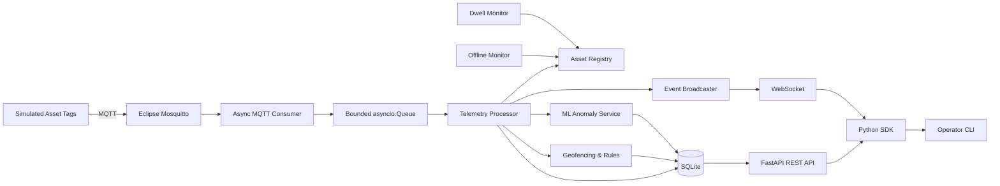

# VectorPulse

**Async Industrial Asset Tracking and Predictive Monitoring Platform**

VectorPulse is a Python-based industrial edge monitoring platform that simulates tracked assets, ingests telemetry over MQTT, maintains reliable asset state, exposes REST and WebSocket interfaces, and detects operational anomalies using deterministic rules and machine learning.

[](https://github.com/AngeloMiletic16/vector-pulse/actions/workflows/ci.yml)
[](https://github.com/AngeloMiletic16/vector-pulse/actions/workflows/release.yml)


## Overview

VectorPulse models an industrial factory or warehouse in which simulated asset tags continuously publish location, motion, and condition telemetry.

The project focuses on practical Python edge/IoT engineering concerns:

- asynchronous MQTT ingestion with `asyncio`
- bounded producer/consumer processing
- schema validation and telemetry sequence integrity
- persistent asset state and history
- geofencing and operational monitoring rules
- REST and WebSocket interfaces
- Python SDK and operator CLI
- ML-based novelty detection
- Docker deployment and automated CI/CD validation

The simulated facility contains four logical zones:

`receiving → storage → assembly → shipping`

Each telemetry message can include position, speed, temperature, vibration, battery level, position quality, sequence number, and device timestamp.

## 📊 Architecture



The backend runs MQTT consumption, telemetry processing, offline monitoring, and dwell monitoring concurrently with `asyncio.TaskGroup`.

A bounded `asyncio.Queue` separates ingestion from processing so telemetry bursts cannot cause unbounded memory growth.

## Key Features

| Area | What VectorPulse provides |
| --- | --- |
| **Async ingestion** | MQTT consumption with `aiomqtt`, reconnect handling, concurrent processing, and a bounded queue |
| **Telemetry integrity** | Pydantic validation, duplicate rejection, out-of-order rejection, gap detection, and per-tag sequence tracking |
| **Asset state** | Online/offline state, latest telemetry, last-seen tracking, zone state, and restart recovery |
| **Industrial monitoring** | Geofencing, zone transitions, dwell alerts, excessive speed, impossible movement, and low-battery monitoring |
| **Persistence** | SQLite storage for current state, telemetry history, transitions, and alerts |
| **Interfaces** | FastAPI REST API, live WebSocket events, async Python SDK, and Typer/Rich CLI |
| **Machine learning** | Robust-scaled One-Class SVM novelty detection with persisted model lifecycle |
| **Delivery** | Docker Compose, GitHub Actions CI, Docker smoke tests, release workflow, and GHCR publishing |

VectorPulse can emit events including:

`asset_online`, `asset_offline`, `zone_entered`, `zone_exited`, `dwell_time_exceeded`, `excessive_speed`, `impossible_movement`, `low_battery`, and `anomaly_detected`.

Duplicate and out-of-order telemetry is rejected before monitoring rules and ML evaluation, preventing invalid messages from manipulating monitoring state.

## ⚡ Quick Start

### Prerequisites

- Docker with Docker Compose
- Git
- `uv` only for local development, SDK/CLI usage, or tests

### 1. Clone the repository

```bash
git clone https://github.com/AngeloMiletic16/vector-pulse.git
cd vector-pulse
```

### 2. Start the complete demo stack

```bash
docker compose --profile demo up --build
```

This starts Mosquitto, the VectorPulse backend, and simulated industrial asset tags.

API:

```text
http://127.0.0.1:8000
```

Interactive FastAPI documentation:

```text
http://127.0.0.1:8000/docs
```

### 3. Verify the system

```bash
curl http://127.0.0.1:8000/health
```

Expected response:

```json
{"status":"ok"}
```

Inspect tracked assets directly from the production container:

```bash
docker compose exec backend vectorpulse assets list
```

Stop the demo:

```bash
docker compose --profile demo down
```

<details>
<summary><strong>Local development setup</strong></summary>

```bash
uv sync --dev

docker compose up -d mosquitto
uv run python -m vector_pulse.gateway
```

Run the simulator in another terminal:

```bash
uv run python -m vector_pulse.simulator.publisher
```

Main environment variables:

| Variable | Default |
| --- | --- |
| `VECTORPULSE_MQTT_HOST` | `localhost` |
| `VECTORPULSE_MQTT_PORT` | `1883` |
| `VECTORPULSE_DATABASE_PATH` | `data/vectorpulse.db` |
| `VECTORPULSE_API_HOST` | `127.0.0.1` |
| `VECTORPULSE_API_PORT` | `8000` |
| `VECTORPULSE_TELEMETRY_QUEUE_MAX_SIZE` | `1000` |

</details>

## 🧠 Machine Learning

VectorPulse adds ML-based monitoring on top of deterministic industrial rules.

The anomaly model learns the normal operating region from accepted historical telemetry:

```text
Telemetry
   ↓
Feature extraction
   ↓
RobustScaler
   ↓
One-Class SVM
   ↓
Novelty / anomaly decision
```

The model uses five operational features:

- `temperature_c`
- `vibration_rms`
- `speed_mps`
- `battery_percent`
- `position_quality`

Identifiers, sequence numbers, timestamps, and raw `x/y` coordinates are deliberately excluded so that identity or location alone does not make an asset anomalous.

Training data comes from telemetry already accepted and persisted by the gateway. The trained `joblib` model is stored next to the SQLite database and loaded again on backend startup.

Runtime inference uses consecutive-anomaly confirmation and cooldown logic to reduce noisy one-sample alerts.

```bash
uv run vectorpulse ml status
uv run vectorpulse ml train --limit 500 --nu 0.03
```

> The anomaly score is a novelty score, not a probability of equipment failure. VectorPulse detects unusual operating behavior; it does not claim to predict exact time-to-failure.

## Interfaces

### Operator CLI

After `uv sync --dev`:

```bash
uv run vectorpulse health
uv run vectorpulse assets list
uv run vectorpulse zones
uv run vectorpulse rules
uv run vectorpulse alerts
uv run vectorpulse events watch --alerts-only
uv run vectorpulse ml status
```

Inspect one asset:

```bash
uv run vectorpulse assets show tag-001
uv run vectorpulse assets telemetry tag-001 --limit 10
uv run vectorpulse assets alerts tag-001
```

Machine-readable JSON is available on supported commands such as:

```bash
uv run vectorpulse assets list --json
uv run vectorpulse alerts --json
uv run vectorpulse ml status --json
```

### Python SDK

```python
import asyncio

from vector_pulse.sdk import VectorPulseClient


async def main() -> None:
    async with VectorPulseClient(
        "http://127.0.0.1:8000"
    ) as client:
        health = await client.health()
        assets = await client.list_assets()

        print(health.status)

        for asset in assets:
            print(asset.telemetry.tag_id, asset.status.value)


asyncio.run(main())
```

<details>
<summary><strong>REST and WebSocket endpoints</strong></summary>

| Method | Endpoint | Purpose |
| --- | --- | --- |
| `GET` | `/health` | Backend health |
| `GET` | `/assets` | Current asset states |
| `GET` | `/assets/{tag_id}` | One asset |
| `GET` | `/assets/{tag_id}/telemetry` | Telemetry history |
| `GET` | `/assets/{tag_id}/zone-transitions` | Zone history |
| `GET` | `/alerts` | Recent alerts |
| `GET` | `/assets/{tag_id}/alerts` | Alerts for one asset |
| `GET` | `/zones` | Geofence configuration |
| `GET` | `/monitoring-rules` | Monitoring configuration |
| `GET` | `/ml/anomaly/status` | ML model status |
| `POST` | `/ml/anomaly/train` | Train the anomaly model |
| `WS` | `/ws/assets` | Live asset and alert events |

</details>

## 🧪 Testing & Quality

VectorPulse currently contains **113 unit and integration tests** covering ingestion, application rules, persistence, API behavior, SDK/CLI behavior, simulator logic, ML lifecycle, and runtime integration.

```bash
uv run ruff check .
uv run pytest -q
```

Additional validation:

```bash
uv build

docker compose config -q
docker compose --profile demo config -q

bash scripts/ci/docker_smoke_test.sh
```

The Docker smoke test exercises the real containerized flow: MQTT ingestion, REST health, CLI access, SQLite persistence across backend restart, fresh telemetry after restart, and the simulator profile.

## 🚀 CI/CD & Releases

GitHub Actions validates every push to `main` and every pull request with two stages:

**Python quality**
- locked dependency installation
- Ruff
- full pytest suite
- CLI and SDK validation
- Python package build

**Docker integration**
- Compose validation
- production image build
- full Docker smoke test

A separate release workflow validates release candidates. Semantic version tags such as `v1.0.0` trigger Docker image publishing to GitHub Container Registry and creation of a GitHub Release containing Python wheel and source-distribution artifacts.

Dependabot checks GitHub Actions dependencies weekly.

## Project Structure

```text
vector-pulse/
├── .github/workflows/      # CI and release delivery
├── docker/mosquitto/       # MQTT broker configuration
├── scripts/ci/             # Docker end-to-end smoke test
├── src/vector_pulse/
│   ├── api/                # FastAPI REST + WebSocket API
│   ├── application/        # Asset state, rules, geofencing, monitors
│   ├── cli/                # Operator CLI
│   ├── ingestion/          # MQTT consumer and telemetry schemas
│   ├── ml/                 # Feature extraction, model, anomaly service
│   ├── persistence/        # SQLite and ML training repository
│   ├── sdk/                # Async Python client
│   ├── simulator/          # Concurrent simulated asset tags
│   ├── gateway.py          # Integrated backend runtime
│   └── settings.py         # Environment-based configuration
├── tests/
│   ├── integration/
│   └── unit/
├── Dockerfile
├── docker-compose.yml
├── pyproject.toml
└── uv.lock
```

## Documentation

Detailed engineering and usage documentation lives in `docs/`:

- [Architecture](docs/ARCHITECTURE.md) — runtime components, async design, data flow, persistence, rules, ML, and trade-offs
- [Requirements](docs/REQUIREMENTS.md) — functional/non-functional requirements and design decisions
- [Testing](docs/TESTING.md) — unit, integration, Docker E2E, manual acceptance, and final release procedure
- [Role Traceability](docs/TRACEABILITY.md) — targeted Python Developer requirements mapped to concrete repository evidence
- [Developer Guide](docs/DEVELOPER_GUIDE.md) — local setup, configuration, development workflow, quality gates, and packaging
- [Operator Guide](docs/OPERATOR_GUIDE.md) — Docker runtime, CLI usage, alerts, live events, ML operations, and troubleshooting

## Engineering Notes

A few design choices are intentional:

- **MQTT is the ingestion boundary.** Simulated devices act as external producers rather than calling backend functions directly.
- **The queue is bounded.** Backpressure is preferable to unbounded memory growth during telemetry bursts.
- **Sequence integrity is checked first.** Duplicate or stale telemetry cannot influence rules or ML state.
- **SQLite stores current and historical state.** Persisted assets are restored as offline until fresh telemetry arrives after restart.
- **Rules and ML complement each other.** Deterministic physical limits stay explicit, while the One-Class SVM handles novelty outside learned normal behavior.
- **Model artifacts are trusted local application data.** Untrusted `joblib` files should never be loaded.

## Tech Stack

**Runtime:** Python 3.13, Asyncio, FastAPI, Uvicorn, Pydantic  
**Messaging:** MQTT, aiomqtt, Eclipse Mosquitto  
**Persistence:** SQLite, aiosqlite  
**Interfaces:** HTTPX, WebSockets, Typer, Rich  
**Machine Learning:** scikit-learn, RobustScaler, One-Class SVM, joblib  
**Quality & Delivery:** pytest, pytest-asyncio, Ruff, uv, Docker, GitHub Actions, Dependabot

## Author

**Angelo Miletić**

Built as a hands-on industrial Python engineering project focused on asynchronous systems, edge/IoT communication, reliable telemetry processing, monitoring, testing, deployment, and applied machine learning.
