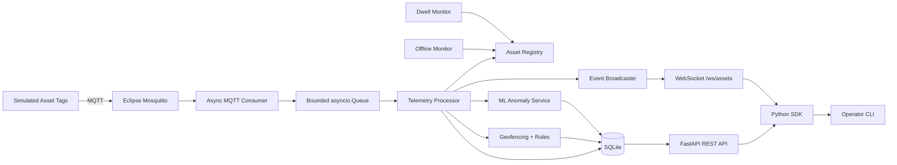

# VectorPulse Architecture

VectorPulse is an asynchronous industrial asset tracking and predictive monitoring platform. It models a small edge/IoT system in which external asset tags publish telemetry over MQTT and a Python gateway validates, processes, persists, exposes, and monitors that data.

## System Context



The MQTT broker is treated as the device boundary. Simulated tags are separate producers and do not call gateway functions directly.

## Runtime Components

| Component | Responsibility |
| --- | --- |
| `simulator/` | Generates concurrent industrial tag telemetry |
| `ingestion/mqtt_consumer.py` | Connects to MQTT, validates messages, and feeds the processing queue |
| `application/asset_registry.py` | Maintains current in-memory asset state and sequence integrity |
| `application/processor.py` | Coordinates accepted telemetry, rules, persistence, ML, and live events |
| `application/geofencing.py` | Resolves asset positions into factory zones |
| `application/rules.py` | Deterministic dwell, movement, and battery monitoring |
| `application/offline_monitor.py` | Marks stale assets offline |
| `application/dwell_monitor.py` | Evaluates zone dwell thresholds independently of new telemetry |
| `persistence/sqlite_storage.py` | Stores current state, telemetry history, transitions, and alerts |
| `ml/` | Feature extraction, model training/loading, and runtime novelty detection |
| `api/` | FastAPI REST and WebSocket interfaces |
| `sdk/` | Async HTTP/WebSocket client for application developers |
| `cli/` | Typer/Rich operator interface |
| `gateway.py` | Builds the integrated backend runtime |

## Async Design

The gateway runs long-lived responsibilities concurrently with `asyncio.TaskGroup`:

1. MQTT consumer
2. telemetry processor
3. offline monitor
4. dwell monitor

The MQTT consumer and telemetry processor are separated by a bounded `asyncio.Queue`. The default maximum size is `1000`.

This separation is intentional:

- MQTT ingestion can continue independently while processing work is scheduled.
- backpressure is explicit instead of allowing unbounded memory growth.
- the processing stage has one clear acceptance boundary for persistence and monitoring.

CPU-bound ML training and model file operations are moved away from the event loop so normal API and telemetry work remain responsive.

## Telemetry Processing Pipeline

Accepted telemetry follows this logical path:

```text
MQTT payload
   ↓
Pydantic schema validation
   ↓
AssetRegistry sequence check
   ├── duplicate      → reject
   ├── out-of-order   → reject
   ├── gap            → accept + report gap
   └── next sequence  → accept
   ↓
movement evaluation
   ↓
geofence evaluation
   ↓
current asset state
   ↓
SQLite persistence
   ↓
deterministic alerts + ML inference
   ↓
EventBroadcaster
   ↓
WebSocket subscribers
```

Duplicate and out-of-order messages leave the processor before rule and ML evaluation. This prevents stale or repeated telemetry from manipulating alert state.

## Asset State and Reliability

Each asset tracks latest accepted telemetry, sequence state, online/offline status, server-side `last_seen`, current zone, zone-entry time, and dwell alert state.

On backend startup, persisted asset states are restored from SQLite and forced offline. A device becomes online again only after fresh accepted telemetry arrives. Sequence gaps are accepted but reported so later telemetry remains useful after packet loss.

## Geofencing and Monitoring Rules

The simulated facility contains four zones:

```text
receiving → storage → assembly → shipping
```

Deterministic monitoring covers conditions that are better expressed as explicit engineering rules:

- dwell time exceeded
- excessive reported speed
- physically implausible calculated movement
- low battery threshold crossing

Low-battery monitoring alerts when a tag first enters the low-battery state rather than on every later low reading. Recovery above the threshold allows a future crossing to alert again.

## Persistence Model

SQLite is the local durable store for current asset state, accepted telemetry history, zone transitions, and monitoring alerts.

The Docker deployment mounts `/app/data` as a named volume, so the SQLite database survives backend container recreation and restart.

SQLite was chosen because VectorPulse is a focused single-edge-node platform. A larger multi-node system would likely move persistence to a networked database.

## REST and WebSocket Interfaces

FastAPI exposes current and historical system state over HTTP. Live asset and alert events are broadcast through:

```text
/ws/assets
```

REST is the durable/query interface; WebSocket is the live event interface.

## Python SDK and CLI

`VectorPulseClient` wraps HTTP and WebSocket communication for application developers.

The `vectorpulse` CLI is built on top of the SDK rather than reading application internals or SQLite directly.

## Machine Learning Pipeline

VectorPulse uses novelty detection instead of supervised failure classification.

```text
accepted historical telemetry
   ↓
feature extraction
   ↓
RobustScaler
   ↓
One-Class SVM
   ↓
persisted joblib model
   ↓
runtime inference
   ↓
consecutive anomaly confirmation
   ↓
anomaly_detected alert
```

Model features:

- `temperature_c`
- `vibration_rms`
- `speed_mps`
- `battery_percent`
- `position_quality`

Tag identity, sequence numbers, timestamps, and raw coordinates are deliberately excluded. The anomaly score is a novelty score, not a probability of equipment failure.

The model artifact is trusted local application data. `joblib` model files must not be accepted from untrusted sources.

## Deployment

Docker Compose provides:

- `mosquitto` — MQTT broker
- `backend` — integrated VectorPulse gateway/API
- `simulator` — optional `demo` profile

The backend runs on Linux, installs locked production dependencies, runs as non-root user `10001`, persists `/app/data`, and exposes port `8000`.

Inside Compose, the backend reaches MQTT by service name `mosquitto`; `localhost` inside a container refers to that container itself.

## CI/CD

CI validates locked dependency installation, Ruff, pytest, CLI/SDK entry points, Python package build, Compose configuration, Docker image build, and the end-to-end smoke test.

Semantic version tags such as `v1.0.0` trigger release validation, Python distribution build, GHCR Docker publishing, and GitHub Release creation.

## Design Trade-offs and Boundaries

VectorPulse intentionally remains a focused single-node edge platform:

- SQLite instead of PostgreSQL
- one integrated backend instead of many microservices
- one global anomaly model instead of per-asset-class models
- simulated MQTT tags instead of physical embedded hardware
- in-memory event broadcasting for live WebSocket clients

Possible production extensions include authenticated APIs, TLS-secured MQTT, device authorization, metrics/observability, per-asset-class ML models, remote model governance, and distributed persistence.
